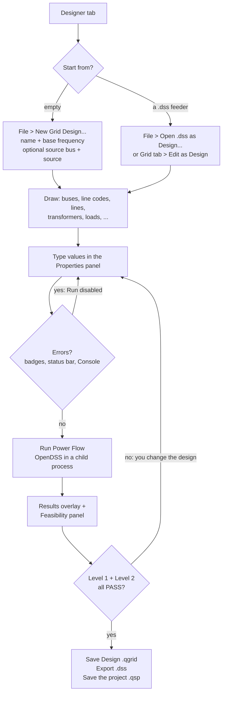

# Grid Network Designer: user flow with a worked example (v0.5)

This document walks through the Grid Network Designer from an empty window to a checked,
saved feeder design. It uses one small example feeder all the way through, and checks
the results by hand so you can see where each number in the feasibility panel comes from.

- **Who it is for:** anyone using the designer for the first time, and anyone who wants
  to understand the numbers it reports.
- **What you need:** `pip install -e ".[dev,grid]"` (dss-python installed), then
  `python -m app`. Without the `grid` extra you can still create, edit, check and save
  designs; only **Run Power Flow** needs OpenDSS.
- **Values:** every electrical value in the example is an input chosen for this document,
  not real equipment data. The designer never invents electrical values: you type them
  or copy them from an element that is already in the design.

The results quoted here are from running the example through the designer's own
controller (the same calls the buttons make) with dss-python 0.15.7 on Windows 11.
OpenDSS does the solving; QtSpice has no power-flow solver of its own.

---

## 1. The user flow at a glance



Every edit is one undo step (Ctrl+Z / Ctrl+Y), and any edit after a run marks the
results as out of date until you run again.

---

## 2. The example feeder

A 12.47 kV substation feeds a 2 km three-phase line. At the end of the line (bus `b1`)
there is a large 12.47 kV load and a 500 kVA transformer that steps down to 480 V for a
second customer (bus `b2`).

```
  sourcebus             l1  (2000 m, lc1)             b1        tx1 500 kVA        b2
 ====+=======--------------------------------------=====+=====--(D)(Y)--=====+=====
     |                                                  |      12.47/0.48 kV    |
 [source]  12.47 kV                                   [ld1]                   [ld2]
  R1 = 0.1, X1 = 1.0 ohm                        3000 kW + 1000 kvar      400 kW + 100 kvar
```

| Element | Type | Values typed |
|---|---|---|
| `source` | Source (created with the design) | 12.47 kV, R1 = 0.1 ohm, X1 = 1.0 ohm, R0 = 0.1 ohm, X0 = 1.0 ohm |
| `lc1` | Line code, 3 phase | R = 0.3 ohm/km, X = 0.6 ohm/km on the diagonal, 0 off the diagonal; C = 0 nF/km |
| `l1` | Line `sourcebus` -> `b1` | linecode `lc1`, length 2000 m, normal rating 200 A |
| `ld1` | Load at `b1` | 3000 kW, 1000 kvar (kV 12.47 filled in from the bus) |
| `tx1` | Transformer `b1` -> `b2` | winding 1: delta, 12.47 kV (filled in), 500 kVA, 1 %R; winding 2: wye, 0.48 kV, 500 kVA, 1 %R; Xhl = 5 % |
| `ld2` | Load at `b2` | 400 kW, 100 kvar (kV 0.48 filled in from the bus) |

The line code has no mutual terms (zero off the diagonal) so the hand calculations in
section 5 stay simple: each phase sees R = 0.3 x 2 = **0.6 ohm** and
X = 0.6 x 2 = **1.2 ohm**.

The limits are the defaults: voltage band 0.95 to 1.05 pu, line and transformer
loading limit 100 %, "near the limit" from 90 % of the limit.

---

## 3. Step by step

### Step 1: Create the design

1. Click the **Designer** tab. The canvas says *No grid design open*; **Run** is disabled.
2. **File > New Grid Design...**
   - Name: `feeder_demo`
   - Base frequency: `60`. The field starts empty because QtSpice never assumes 60 Hz.
   - Tick **Start with a source bus and a 3-phase source**, keep the bus name
     `sourcebus`, type kV `12.47`, R1 `0.1`, X1 `1.0`, R0 `0.1`, X0 `1.0`.
   - OK stays disabled until every one of these is filled in.
3. Click **OK**. The canvas shows the `sourcebus` bus bar with the source under it. The
   status bar says `feeder_demo: 1 buses, 1 elements`.

### Step 2: Add the line code

1. Click **Line code** in the library. `lc1` appears under *Line codes in this design*
   (line codes are not drawn on the canvas) and is selected.
2. In the Properties panel type the matrices row by row and press Enter after each:
   - R matrix: `0.3 0 0 0 0.3 0 0 0 0.3`
   - X matrix: `0.6 0 0 0 0.6 0 0 0 0.6`
   - C matrix: `0 0 0 0 0 0 0 0 0`

   The red "... not set" text under each field disappears as you type it.

### Step 3: Add bus `b1` and line `l1`

1. Click **Bus** in the library, then click the canvas below `sourcebus`. Bus `b1`
   appears on the nearest grid point and is selected.
2. Click the **Line** tool, click `sourcebus`, then `b1`. Line `l1` joins the two bus
   bars. Press Esc to leave the tool.
3. `l1` gets a red **!** badge. The new line only has its structural values (buses and
   phases), so the Console lists:
   ```
   line.l1: unknown linecode ''
   line.l1: length 0 m is not > 0
   ```
4. Select `l1` and in Properties set **linecode** `lc1`, **length** `2000` (m) and
   **normal rating** `200` (A). The badge goes away.

   If you leave out the rating, the line still runs, but the feasibility panel reports
   it as "no rating" and does not check its loading. QtSpice never guesses a rating.

### Step 4: Add load `ld1`

1. Drag **Load** from the library onto `b1`. `ld1` appears under `b1`, joined by a grey
   stub. Its kV (12.47) and phases (3) come from the bus.
2. It has a red badge: `load.ld1: kW not set`, `load.ld1: kvar not set`.
3. Hover over **Run Power Flow**: the tooltip says *The design has N error(s) (see the
   Console)*. Clicking the error count in the status bar opens the Console.
4. Select `ld1` and type kW `3000` and kvar `1000`.

### Step 5: Add bus `b2` and transformer `tx1`

1. Add bus `b2` to the right of `b1` (Bus in the library, click the canvas).
2. Click the **Transformer** tool, click `b1`, then `b2`. The Console now lists what the
   transformer still needs:
   ```
   transformer.tx1: winding 1 kVA not set
   transformer.tx1: winding 1 %R not set
   transformer.tx1: winding 2 kV not set
   transformer.tx1: winding 2 kVA not set
   transformer.tx1: winding 2 %R not set
   transformer.tx1: Xhl (%) not set
   ```
   Winding 1 already has 12.47 kV because `b1` is in the 12.47 kV voltage zone of the
   source. Winding 2 has no kV yet because `b2` is not in any zone until this
   transformer gives it one.
3. Select `tx1` and fill in:

   | Field | Value |
   |---|---|
   | winding 1 conn | `delta` |
   | winding 1 kVA | `500` |
   | winding 1 %R | `1` |
   | winding 2 kV | `0.48` |
   | winding 2 kVA | `500` |
   | winding 2 %R | `1` |
   | Xhl (%) | `5` |

   `b2` is now in the 0.48 kV zone.

### Step 6: Add load `ld2`

Drag **Load** onto `b2`. It gets kV 0.48 from the zone. Type kW `400` and kvar `100`.

The status bar now shows 0 errors and **Run Power Flow** is enabled. This is
**Level 1** of the feasibility check: topology and validation (every bus reached from a
source, no islands, phases available at every bus, no line between two voltage zones,
no missing value).

### Step 7: Run the power flow (Run 1)

Click **Run Power Flow** (or the main tool bar **Run** while the Designer tab is shown).
The design is written as a DSS script and solved by OpenDSS in a separate process. The
status bar says:

```
Finished: converged in 3 iterations (1 control), losses 60.1 kW
```

The drawing is coloured by the lowest phase voltage of each bus and by branch loading
(thicker = more loaded). The **Feasibility panel** shows:

| Level 2 check | Worst value | Worst element | Limit | Status |
|---|---|---|---|---|
| Lowest voltage | **0.9391 pu** | `bus.b2` | 0.95 pu | **FAIL** |
| Highest voltage | 0.9896 pu | `bus.sourcebus` | 1.05 pu | PASS |
| Line loading | 85.6 % (171.3 A of 200 A) | `line.l1` | 100 % | PASS |
| Transformer loading | 82.9 % (414.3 kVA of 500 kVA) | `transformer.tx1` | 100 % | PASS |

| Summary | Run 1 |
|---|---|
| Load entered | 3400 kW, 1100 kvar |
| Supplied by the source | 3450.5 kW, 1221.5 kvar |
| Losses | 60.1 kW, 123.9 kvar |
| Largest voltage drop from the source | 0.0505 pu at `b2` (path `line.l1` -> `transformer.tx1`) |

Node voltages (all three phases are equal because the design is balanced):

| Bus | Run 1 (pu) |
|---|---|
| sourcebus | 0.98959 |
| b1 | 0.96686 |
| b2 | **0.93911** |

Click the *Lowest voltage* row to select `b2` on the drawing.

### Step 8: Change the design and run again (Run 2)

The designer does not suggest a fix: the engineering decision is yours. In this example
we raise the voltage on the 480 V side with the transformer tap:

1. Select `tx1` and set **winding 2 tap** to `1.025` (+2.5 %).
2. The overlay is marked out of date. Click **Run Power Flow** again.

| Level 2 check | Run 1 | Run 2 (tap 1.025) | Status in Run 2 |
|---|---|---|---|
| Lowest voltage | 0.9391 pu at b2 | **0.9617 pu** at b2 | PASS |
| Highest voltage | 0.9896 pu | 0.9896 pu | PASS |
| Line loading | 85.6 % | 85.9 % | PASS |
| Transformer loading | 82.9 % | 85.0 % | PASS |
| Losses | 60.1 kW | 60.8 kW | - |
| Source supplies | 3450.5 kW | 3460.7 kW | - |

| Bus | Run 1 (pu) | Run 2 (pu) |
|---|---|---|
| sourcebus | 0.98959 | 0.98955 |
| b1 | 0.96686 | 0.96676 |
| b2 | 0.93911 | **0.96174** |

Every check passes. Note what else changed, which section 5.5 explains: the source now
supplies about 10 kW more, and both loadings went up slightly.

### Step 9: Save and export

- **File > Save Design** asks for a file name the first time (`feeder_demo.qgrid`). The
  `.qgrid` file holds the grid model and the drawing, never results.
- **File > Export .dss...** writes a self-contained OpenDSS script (`feeder_demo.dss`)
  with the bus positions as `SetBusXY` lines.
- **File > Save** (the project) stores the design in the `.qsp` project (format version 5),
  together with its power-flow settings and limits. The DSS script of each run is kept
  under `<project>_results/grid/feeder_demo/`.

---

## 4. A snapshot is not proof

The feasibility report checks **one** power flow at the loads you entered. It does not
show that the design works at other load levels, under contingencies (outages,
switching) or with its protection. The panel says so with every report. Load growth,
scenarios and time-series studies are planned for later versions (0.7 and 0.8+).

---

## 5. Checking the results by hand

These are hand estimates for checking the results, not a replacement for the solver.
They use the per-phase approximation of voltage drop

```
dV  ~=  (R * P + X * Q) / V_LL          (3-phase P, Q in W and var; R, X in ohm per phase)
```

which ignores the small quadrature part of the drop. For short distribution lines it is
usually within a few tenths of a percent of the exact solution.

Base values:

| Zone | V_LL base | V_LN base | Z base at 500 kVA |
|---|---|---|---|
| 12.47 kV | 12 470 V | 7 199.6 V | 12.47^2 / 0.5 = 311.0 ohm |
| 0.48 kV | 480 V | 277.1 V | 0.48^2 / 0.5 = 0.4608 ohm |

### 5.1 Drop across the source impedance (Run 1)

The source supplies P = 3450.5 kW and Q = 1221.5 kvar through R1 = 0.1 ohm and
X1 = 1.0 ohm:

```
dV = (0.1 * 3 450 500 + 1.0 * 1 221 500) / 12 470
   = (345 050 + 1 221 500) / 12 470
   = 125.6 V   ->  125.6 / 12 470 = 0.0101 pu

V(sourcebus) ~= 1.0000 - 0.0101 = 0.9899 pu      OpenDSS: 0.98959 pu
```

The source bus is below 1.0 pu because the source is an ideal 12.47 kV voltage behind
its own impedance. The losses in that impedance (3 x 171.25^2 x 0.1 = 8.8 kW) are not in
the reported losses: those count only the elements of the design.

### 5.2 Line current and loading

The current at terminal 1 of `l1` comes from the power that enters the line at
`sourcebus` (0.98959 x 12 470 = 12 340 V):

```
|S| = sqrt(3450.5^2 + 1221.5^2) = 3660.3 kVA
I   = |S| / (sqrt(3) * V_LL) = 3 660 300 / (1.732 * 12 340) = 171.25 A

Line loading = I / norm_amps = 171.25 / 200 = 85.6 %     OpenDSS: 85.6 %
```

85.6 % is below the 90 % "near the limit" mark (90 % of 100 %), so the check is PASS.

### 5.3 Drop along the line and the line losses

With R = 0.6 ohm and X = 1.2 ohm per phase:

```
dV = (0.6 * 3 450 500 + 1.2 * 1 221 500) / 12 340
   = (2 070 300 + 1 465 800) / 12 340
   = 286.6 V   ->  286.6 / 12 470 = 0.0230 pu

V(b1) ~= 0.98959 - 0.0230 = 0.9666 pu      OpenDSS: 0.96686 pu
```

The line has no shunt capacitance, so the current is the same along the whole line and
its losses are exactly I^2 R per phase:

```
P_loss(line) = 3 * 171.25^2 * 0.6 = 52.8 kW
Q_loss(line) = 3 * 171.25^2 * 1.2 = 105.6 kvar
```

### 5.4 Transformer drop and why b2 fails (Run 1)

Referred to the 480 V side, the transformer's series impedance is

```
R = (1 % + 1 %) * 0.4608 = 0.009216 ohm
X = 5 %         * 0.4608 = 0.02304  ohm
```

With the 400 kW / 100 kvar load at roughly 0.939 x 480 = 450.8 V:

```
dV = (0.009216 * 400 000 + 0.02304 * 100 000) / 450.8
   = (3 686 + 2 304) / 450.8
   = 13.3 V   ->  13.3 / 480 = 0.0277 pu

V(b2) ~= 0.96686 - 0.0277 = 0.9392 pu      OpenDSS: 0.93911 pu  (< 0.95: FAIL)
```

Adding up the drops from the source to `b2`:

| Part | Drop (pu) |
|---|---|
| line `l1` | 0.0227 |
| transformer `tx1` | 0.0278 |
| **from sourcebus to b2** | **0.0505** (the "largest voltage drop" in the panel) |

The line alone takes `b1` to 0.967 pu, and the transformer's 2.8 % drop pushes `b2` below
0.95 pu.

The transformer losses are the rest of the total:
60.1 - 52.8 = **7.3 kW** and 123.9 - 105.6 = **18.4 kvar**.

### 5.5 A load model detail: why the source supplies less in Run 1

The loads use the constant-power model (`pq`, OpenDSS load model 1), but **only between
Vminpu and Vmaxpu** (0.95 to 1.05 pu by default). Below 0.95 pu OpenDSS treats the load
as a constant impedance, so its power falls with the square of the voltage:

```
P(ld2) ~= 400 * (0.93911 / 0.95)^2 = 400 * 0.977 = 391 kW      (instead of 400 kW)
Q(ld2) ~= 100 * 0.977              =  98 kvar
```

You can see it in the energy balance: the source supplies 3450.5 kW, which is
3000 (ld1) + about 390 (ld2) + 60.1 (losses). It is not 3400 + 60.1 = 3460.1 kW.

In Run 2 `b2` is back above 0.95 pu, `ld2` draws its full 400 kW, and the balance closes
exactly: 3400 + 60.8 = 3460.8 kW (OpenDSS: 3460.7 kW). This is why the source power and
the loadings go up slightly in Run 2 even though no load changed.

**Lesson:** when a bus is below the voltage band, the solved load is smaller than the
one you entered, so the reported losses and loadings are slightly *optimistic* for that
snapshot. Fix the voltage first, then read the loadings.

The transformer loading uses the same reasoning. It is the largest |S| at a winding
terminal divided by kVA, and the largest is on the 12.47 kV side, because that side also
carries the transformer's own losses:

```
Run 1:  S(HV) = (391 + 7.3) + j(98 + 18.4)  ->  |S| = 414.8 kVA  ->  83 %   OpenDSS: 414.3 kVA, 82.9 %
```

### 5.6 The tap change (Run 2)

A tap of 1.025 on winding 2 makes the ratio 12.47 : 0.492 kV, so at no load `b2` would be
2.5 % higher than `b1`:

```
V(b2, no load) = 0.96676 * 1.025 = 0.99093 pu
```

The tap also changes the impedance referred to the 480 V side, because each winding's
%R and %X are on its own (now 0.492 kV) base: Z base = 0.492^2 / 0.5 = 0.4841 ohm, so
R = 0.009682 ohm and X = 0.02421 ohm. With the full 400 kW / 100 kvar at about
0.962 x 480 = 461.6 V:

```
dV = (0.009682 * 400 000 + 0.02421 * 100 000) / 461.6
   = (3 873 + 2 421) / 461.6
   = 13.6 V   ->  0.0284 pu

V(b2) ~= 0.99093 - 0.0284 = 0.9625 pu      OpenDSS: 0.96174 pu  (> 0.95: PASS)
```

Transformer copper losses, winding by winding:

```
HV:  I = 424.8 kVA / (1.732 * 12.47 * 0.96676) = 20.3 A,  R = 1 % * 311.0 = 3.110 ohm
     P = 3 * 20.3^2 * 3.110 = 3.86 kW
LV:  I = 412.3 kVA / (1.732 * 0.48 * 0.96174) = 515.6 A,  R = 1 % * 0.4841 = 0.004841 ohm
     P = 3 * 515.6^2 * 0.004841 = 3.86 kW
Total = 7.7 kW       OpenDSS: 60.8 - 53.1 (line) = 7.7 kW
```

### 5.7 Summary of hand estimates vs OpenDSS

| Quantity | Hand | OpenDSS | Difference |
|---|---|---|---|
| V(sourcebus), Run 1 | 0.9899 pu | 0.98959 pu | 0.03 % |
| V(b1), Run 1 | 0.9666 pu | 0.96686 pu | 0.03 % |
| V(b2), Run 1 | 0.9392 pu | 0.93911 pu | 0.01 % |
| V(b2), Run 2 | 0.9625 pu | 0.96174 pu | 0.08 % |
| I(l1), Run 1 | 171.25 A | 171.25 A | exact (same S and V) |
| Line losses, Run 1 | 52.8 kW | 52.8 kW | exact (I^2 R) |
| Transformer loading, Run 1 | 83 % | 82.9 % | 0.1 % point |
| Transformer losses, Run 2 | 7.7 kW | 7.7 kW | - |

---

## 6. Things to try next with the same design

Each variant starts from Run 1 (tap 1.0, l1 = 2000 m, ld1 = 3000 kW / 1000 kvar). Estimate
the result with section 5 first, then run to check.

| Variant | Hand estimate | OpenDSS result |
|---|---|---|
| **A. Shorten `l1` to 1000 m** (instead of changing the tap) | line drop halves to about 0.0115 pu: b1 ~= 0.978 pu, b2 ~= 0.951 pu | b1 0.97874 pu, b2 **0.95066 pu** (just inside the band: PASS), losses 33.4 kW, line 84.8 % |
| **B. Increase `ld1` to 3600 kW / 1200 kvar** | S ~= (3600 + 386 + 81) + j(1200 + 96 + 166) = 4067 + j1462 kVA, so I ~= 4322 / (1.732 x 12.31) ~= 203 A, about 101 % | line **101.3 %** (202.6 A): *Line loading* FAIL; b2 0.933 pu: *Lowest voltage* FAIL; losses 81.1 kW |

Variant A passes by only 0.0007 pu, so a small rise in load would make it fail. This is
the "a snapshot is not proof" point from section 4.

You can also **open a real feeder**: *File > Open .dss as Design...* on
`tests/fixtures/grid/ieee13/IEEE13Nodeckt.dss`, or open `examples/ieee13_design.qsp`.

---

## 7. Quick reference: canvas actions

| Action | How |
|---|---|
| Place a bus / line code | Click it in the library, then click the canvas |
| Line, switch, transformer | Branch tool, click bus 1, click bus 2 (Esc leaves the tool) |
| Load, capacitor, PV, source | Drag onto a bus (dropping on empty canvas is refused) |
| Select | Click, Ctrl+click, rubber band; click empty canvas to clear |
| Move / rotate / rename / delete | Drag (snapped) / R / F2 / Del (a bus takes everything on it) |
| Open or close a switch | Double-click it |
| Undo / redo | Ctrl+Z / Ctrl+Y (one step per edit or per drag) |
| Pan / zoom / fit | Middle-drag, right-drag or Space + drag / wheel / *Fit* |
| See errors | Red badges, error count in the status bar, Console |
